# Лабораторная работа №2 - Эксплуатация OpenSearch 3.8

Защищённый Hot-Warm кластер OpenSearch 3.8 с TLS, ролевой моделью, автоматическим управлением
жизненным циклом логов nginx (ISM) и мониторингом через Prometheus + Grafana.

## Содержание

1. [Архитектура](#архитектура)
2. [Структура репозитория](#структура-репозитория)
3. [Запуск](#запуск)
4. [Часть 1. Развертывание](#часть-1-развертывание)
5. [Часть 2. Ролевая модель](#часть-2-ролевая-модель)
6. [Часть 3. Управление индексами](#часть-3-управление-индексами)
7. [Часть 4. Мониторинг](#часть-4-мониторинг)
8. [Выводы](#выводы)

## Архитектура

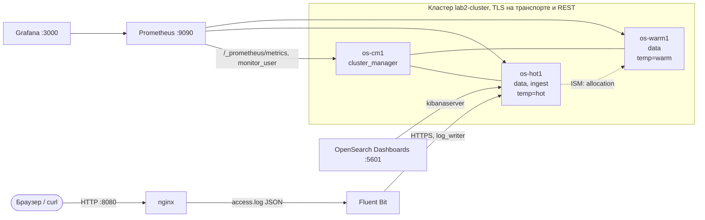

| Сервис | Назначение | Порт на хосте |
|---|---|---|
| `os-cm1` | выделенный cluster manager | - |
| `os-hot1` | hot-узел (data + ingest), точка входа REST | 9200 (только 127.0.0.1) |
| `os-warm1` | warm-узел (data) | - |
| `dashboards` | OpenSearch Dashboards (HTTPS) | 5601 |
| `nginx` | тестовая страница, JSON-логи | 8080 |
| `fluent-bit` | перекладчик логов nginx → OpenSearch | - |
| `prometheus` | сбор метрик | 9090 (127.0.0.1) |
| `grafana` | дашборд | 3000 (127.0.0.1) |

**Hot-Warm.** Узлам назначен атрибут `node.attr.temp` (`hot` / `warm`). Шаблон индекса требует размещение
новых индексов на `temp=hot`, а ISM-политика после ротации меняет требование на `temp=warm` 
и OpenSearch сам перемещает шарды.

## Структура репозитория

```
├── docker-compose.yml            # весь стенд, включая одноразовые init-контейнеры и пароли
├── opensearch/Dockerfile         # образ OpenSearch + плагин prometheus-exporter
├── config/
│   ├── opensearch/               # opensearch.yml для каждого узла
│   └── dashboards/               # opensearch_dashboards.yml
├── api/                          # JSON-тела запросов: роли, шаблон индекса, ISM-политика
├── nginx/                        # nginx.conf (JSON-лог) и страница
├── fluent-bit/                   # конфигурация перекладчика
├── monitoring/                   # prometheus.yml, Grafana (datasource + дашборд)
├── scripts/                      # sh-скрипты, выполняемые ВНУТРИ контейнеров
└── docs/img/                     # скриншоты для отчёта
```

Всё, что обычно делают руками (сертификаты, хэши паролей, создание ролей и пользователей), выполняют одноразовые контейнеры
`certs-init`, `security-init` и `setup`. Сгенерированные файлы лежат в **именованных томах Docker** (`certs`, `security`)

## Запуск
Из каталога проекта:
```
docker compose up -d --build
```

Все происходит автоматически, в таком порядке:

1. `certs-init` создаёт CA и сертификаты (том `certs`);
2. `security-init` считает bcrypt-хэши и создаёт `internal_users.yml` (том `security`). Узлы OpenSearch копируют его на место при старте;
3. стартуют `os-cm1`, `os-hot1`, `os-warm1`, затем Dashboards;
4. `setup` ждёт кластер из 3 узлов и создаёт настройки ISM, роли, пользователей, ISM-политику, шаблон и data stream `logs`;
5. после успешного `setup` стартуют Fluent Bit и Prometheus (Fluent Bit нужен пользователь `log_writer` и data stream `logs`).

Контейнеры `certs-init`, `security-init`, `setup` должны завершиться со статусом `Exited (0)`.

Генерация трафика к nginx:

```
docker compose --profile traffic up -d traffic        # ровный поток запросов
docker compose --profile burst run --rm traffic-burst # 5000 запросов с длинными URI (быстро набрать ~1 МБ)
docker compose stop traffic                           # остановить поток
```

Для того, чтобы выполнить полный сброс (сертификаты и пароли сгенерируются заново) используется следующая команда: `docker compose down -v`.

### Учётные данные для моего стенда

| Логин | Пароль |
|---|---|
| `admin` (OpenSearch) | `Adm1n-Lab2-x7Qp-2026` |
| `log_writer` (Запись логов) | `Writer-Lab2-k9Rv-2026` |
| `log_reader` (Чтение логов) | `Reader-Lab2-d3Wn-2026` |
| `monitor_user` (Мониторинг) | `Monitor-Lab2-b8Hs-2026` |
| `admin` (Grafana) | `Grafana-Lab2-t5Yc-2026` |

Пароли учебные и заданы прямо в `docker-compose.yml`. В реальной эксплуатации их выносят в секреты:)

### Удобный доступ к API

Все `curl`-запросы ниже выполняются внутри контейнера `os-hot1`,
поэтому на хосте ничего ставить не нужно. Определим короткую функцию `os`.

PowerShell:
```powershell
function os { docker compose exec -T os-hot1 curl -s --cacert /usr/share/opensearch/config/certs/root-ca.pem -u admin:Adm1n-Lab2-x7Qp-2026 @args }
# пример:
os "https://localhost:9200/_cluster/health?pretty"
```

Запросы с телом (`PUT`/`POST`) удобнее выполнять в **Dashboards -> Dev Tools** (<https://localhost:5601>),
чтобы не бороться с экранированием кавычек в PowerShell.

---

## Часть 1. Развертывание

### 1.1 Hot-Warm кластер

Конфигурации узлов - [`config/opensearch/`](config/opensearch). Ключевые отличия:

| Узел | `node.roles` | `node.attr.temp` |
|---|---|---|
| os-cm1 | `cluster_manager` | `master` |
| os-hot1 | `data, ingest` | `hot` |
| os-warm1 | `data` | `warm` |

Образ собирается из `opensearchproject/opensearch:3.8.0` с установленным плагином Prometheus
([`opensearch/Dockerfile`](opensearch/Dockerfile)). Демо-конфигурация отключена
(`DISABLE_INSTALL_DEMO_CONFIG=true`), демо-сертификаты и `admin:admin` не используются.

Проверим узлы кластера:  
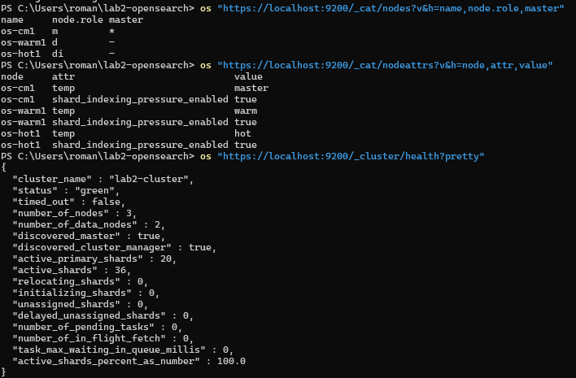

### 1.2 TLS на транспортном и REST уровне

Сертификаты генерирует контейнер `certs-init` скриптом [`scripts/gen-certs.sh`](scripts/gen-certs.sh) (результат в томе `certs`): собственный корневой CA и
сертификаты для `os-cm1`, `os-hot1`, `os-warm1`, `admin` и `dashboards`. В SAN узлов указаны имя
сервиса compose (по нему клиенты REST проверяют имя хоста), `localhost`/`127.0.0.1` (для curl с хоста) и registered ID
`1.2.3.4.5.5` (признак узла кластера). Ключи конвертируются в PKCS#8, как требует OpenSearch.

Настройки в `opensearch.yml`:

```yaml
# Транспортный уровень (узел <-> узел)
plugins.security.ssl.transport.pemcert_filepath: certs/os-hot1.pem        # у каждого узла свой сертификат
plugins.security.ssl.transport.pemkey_filepath: certs/os-hot1-key.pem
plugins.security.ssl.transport.pemtrustedcas_filepath: certs/root-ca.pem
plugins.security.ssl.transport.enforce_hostname_verification: false   # узлы Docker обращаются друг к другу по IP

# REST (клиент <-> узел)
plugins.security.ssl.http.enabled: true
plugins.security.ssl.http.pemcert_filepath: certs/os-hot1.pem
plugins.security.ssl.http.pemkey_filepath: certs/os-hot1-key.pem
plugins.security.ssl.http.pemtrustedcas_filepath: certs/root-ca.pem

plugins.security.nodes_dn: ["CN=os-*,OU=Lab,O=Lab2,C=RU"]   # кто может присоединяться к кластеру
plugins.security.authcz.admin_dn: ["CN=admin,OU=Lab,O=Lab2,C=RU"]
```

Начальная конфигурация security (`allow_default_init_securityindex: true`) загружается из каталога
`opensearch-security` при первом старте; в него при старте узла копируется сгенерированный `internal_users.yml`
с bcrypt-хэшами паролей `admin` и `kibanaserver` (его создаёт контейнер `security-init` с помощью `hash.sh` из плагина security).

Проверим:  
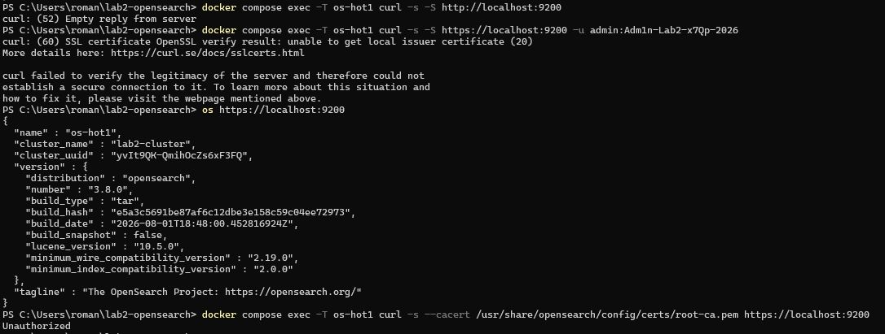

- В первом запросе обычный HTTP не работает (сервер ждёт TLS-рукопожатие)
- Во втором запросе HTTPS без доверия к нашему CA - ошибка проверки сертификата (curl: (60))
- В третьем запросес CA - работает
- В последнем - без пароля(401)

### 1.3 Dashboards

OpenSearch Dashboards подключается к `https://os-hot1:9200` под служебным пользователем
`kibanaserver` с `verificationMode: full` и нашим CA. Сам веб-интерфейс тоже работает по HTTPS ([`config/dashboards/opensearch_dashboards.yml`](config/dashboards/opensearch_dashboards.yml)).

Адрес: <https://localhost:5601>. Вход: `admin` / `Adm1n-Lab2-x7Qp-2026`.

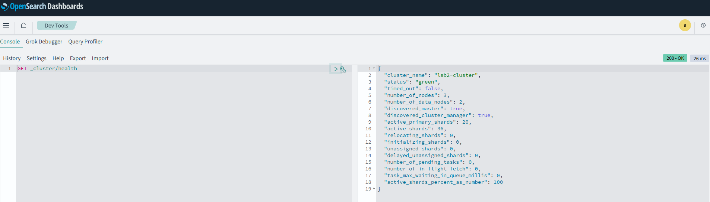

---

## Часть 2. Ролевая модель

Роли описаны в [`api/roles/`](api/roles), создаются контейнером `setup` ([`scripts/setup.sh`](scripts/setup.sh))

| Роль | Пользователь | Права |
|---|---|---|
| `logs_writer` | `log_writer` | `indices:data/write/index`, `indices:data/write/bulk*` только на data stream `logs` (+ его backing-индексы `.ds-logs-*`); на кластере - `indices:data/write/bulk` (нужно для `_bulk`) |
| `logs_reader` | `log_reader` | группа действий `read` только на `logs*` (+ `.ds-logs*`); на кластере - `cluster_composite_ops_ro` (`mget`, `msearch`, `scroll`) |
| `metrics_monitor` | `monitor_user` | `cluster:monitor/prometheus/metrics`, `cluster:monitor/{main,health,state,stats,nodes/stats,nodes/info}`; на индексах `*` - только `indices:monitor/stats` |

Пользователи сопоставление с ролями через `rolesmapping`:

```
PUT _plugins/_security/api/rolesmapping/logs_writer
{ "users": ["log_writer"] }
```

Роль записи не имеет права чтения, роль чтения - права записи, роль мониторинга не имеет доступа к данным.

### Проверка прав
Запускается следующей командой:
```
docker compose --profile check run --rm rbac-check
```

Скрипт [`scripts/rbac-check.sh`](scripts/rbac-check.sh) выполняет по очереди запросы от имени всех трёх
пользователей и сравнивает HTTP-коды с ожидаемыми:  
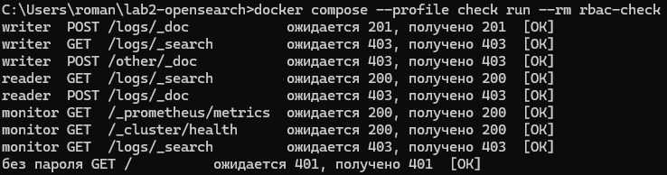

---

## Часть 3. Управление индексами

### 3.1 nginx с JSON-логами

Тестовая страница: [`nginx/html/index.html`](nginx/html/index.html). В
[`nginx/nginx.conf`](nginx/nginx.conf) задан `log_format json_logs escape=json`.

Лог пишется в файл на общем томе `nginx-logs`, чтобы Fluent Bit мог его читать.

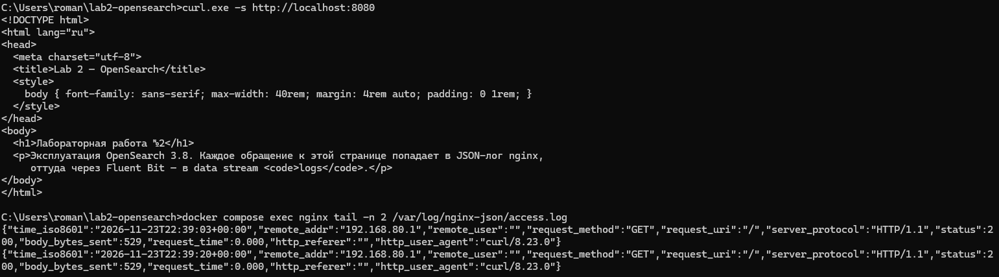

### 3.2 Fluent Bit

Конфигурация агента - [`fluent-bit/fluent-bit.conf`](fluent-bit/fluent-bit.conf):

- Входной плагин tail следит за файлом access.log, а парсер json разбирает каждую строку на отдельные поля. Чтобы при перезапуске контейнера не терять и не дублировать записи, Fluent Bit запоминает до какого места он дочитал файл. Благодаря этому после рестарта чтение продолжается с того же места, а не с начала файла.
- Выходной плагин opensearch отправляет записи в кластер по HTTPS. Соединение защищено: сертификат сервера проверяется по нашему корневому CA, а запись ведётся от имени сервисного пользователя log_writer, у которого есть права только на добавление данных. Логи складываются в Index logs, который является data stream.

Проверим:
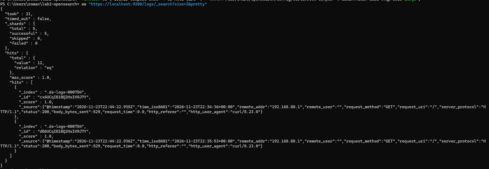

### 3.3 Шаблон индекса

Шаблон лежит в [`api/index-template.json`](api/index-template.json). Это composable-шаблон с именем nginx-logs, который автоматически применяется ко всем индексам для data stream `logs`. Краткое содержание шаблона:
- `data_stream` с полем `@timestamp`;
- 1 шард, 0 реплик, `refresh_interval: 5s`;
- `index.routing.allocation.require.temp: hot` - новые индексы создаются на hot-узле;
- явный маппинг полей nginx

Data stream используется потому, что логи append-only временной ряд: запись идёт в текущий backing-индекс
`.ds-logs-000001`, ISM-ротация создаёт `.ds-logs-000002` и т. д., а клиенты работают с единым именем `logs`.

### 3.4 Политика хранения (ISM)

Политика хранения лежит в [`api/ism-policy.json`](api/ism-policy.json), политика `nginx-logs-policy`:

| Состояние | Действие | Переход |
|---|---|---|
| `hot` | `rollover`: `min_size: 1mb` **или** `min_index_age: 1m` (срабатывает то, что раньше) | в `warm` при `min_index_age: 2m` |
| `warm` | `allocation`: `require.temp = warm` - шарды переезжают на warm-узел | в `delete` при `min_index_age: 10m` |
| `delete` | `delete` - индекс удаляется | - |
---

## Часть 4. Мониторинг

### 4.1 Плагин Prometheus

Используется [opensearch-prometheus-exporter](https://github.com/opensearch-project/opensearch-prometheus-exporter).
Версия плагина должна совпадать с версией OpenSearch, поэтому плагин устанавливается при сборке образа:

```dockerfile
RUN /usr/share/opensearch/bin/opensearch-plugin install --batch \
    https://github.com/opensearch-project/opensearch-prometheus-exporter/releases/download/3.8.0.0/prometheus-exporter-3.8.0.0.zip
```

Плагин должен стоять на каждом узле, который опрашивается. Метрики отдаются на `https://<узел>:9200/_prometheus/metrics`
и защищены той же аутентификацией, поэтому для опроса создан отдельный пользователь `monitor_user` с минимальными правами.

Prometheus ([`monitoring/prometheus.yml`](monitoring/prometheus.yml)) опрашивает все три узла по HTTPS, проверяя сертификат
по нашему CA. Состояние targets: <http://localhost:9090/targets>:  
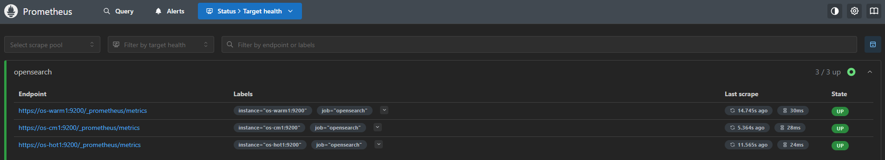
Все три состояния `UP`

### 4.2 Выбранные метрики

| Группа | Метрика | Зачем |
|---|---|---|
| Состояние кластера | `opensearch_cluster_status` (0/1/2 = green/yellow/red) | главный индикатор здоровья |
| | `opensearch_cluster_nodes_number`, `..._datanodes_number` | выпал ли узел |
| | `opensearch_cluster_shards_number{type=active\|unassigned\|relocating}` | неразмещённые шарды - признак проблем с аллокацией |
| | `opensearch_cluster_pending_tasks_number` | очередь задач cluster manager |
| JVM | `opensearch_jvm_mem_heap_used_bytes / ..._max_bytes` | давление на heap |
| | `opensearch_jvm_gc_collection_time_seconds` | долгие GC = «залипание» узла |
| Ресурсы | `opensearch_os_cpu_percent` | загрузка CPU |
| | `opensearch_fs_total_available_bytes / ..._total_bytes` | заполнение диска; при 85/90/95% включаются watermark'и и блокируется запись |
| Производительность | `opensearch_indices_indexing_index_count` (rate) | скорость индексации |
| | `opensearch_indices_search_query_count`, `..._query_time_seconds` | нагрузка и средняя задержка поиска |
| | `opensearch_threadpool_tasks_number{type="rejected"}` | отказы в пулах `write`/`search` - кластер перегружен |
| Данные | `opensearch_indices_doc_number`, `opensearch_indices_store_size_bytes` по узлам | распределение hot/warm |
| | `opensearch_index_doc_number{index=~".ds-logs-.*"}` | наглядно показывает ротацию и удаление индексов ISM |

### 4.3 Дашборд

Grafana: <http://localhost:3000> (`admin` / `Grafana-Lab2-t5Yc-2026`).
Источник данных и дашборд **«OpenSearch - состояние и производительность»**
([`monitoring/grafana/dashboards/opensearch.json`](monitoring/grafana/dashboards/opensearch.json)).

Я запустил профиль `traffic` и наблюдал за метриками.

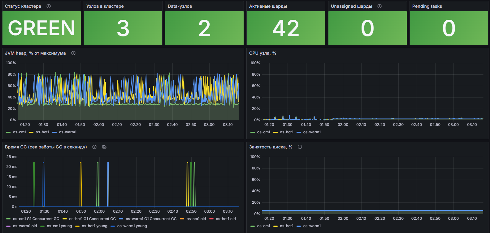
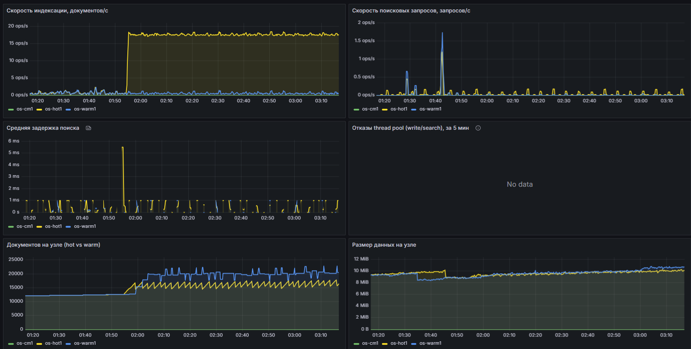
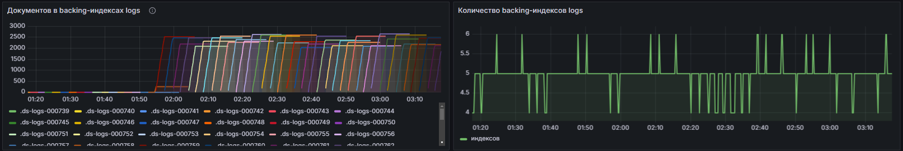

Во время нагрузки все 3 узла были доступны, количество активных шардов составляло 42, неразмещённые шарды и ожидающие задачи отсутствовали. Загрузка CPU оставалась низкой (преимущественно до 5%), занятость диска составляла около 6%. Использование JVM Heap периодически достигало 80–85%, однако затем возвращалось к базовому уровню 25–35%, что свидетельствует об отсутствии устойчивого роста потребления памяти.

Основная нагрузка приходилась на индексацию данных: скорость записи на hot-узле после запуска профиля стабилизировалась на уровне 17–18 документов/с. Поисковая активность оставалась небольшой, средняя задержка большинства запросов не превышала 1 мс. На warm-узле наблюдалось большее количество документов, чем на hot-узле, что отражает распределение данных между уровнями хранения.

Также наблюдалось постепенное заполнение backing-индексов logs до 2 000–2 700 документов и изменение их количества в диапазоне 4–6, что согласуется с работой механизма rollover и политики ISM. Таким образом, эксперимент подтвердил работоспособность кластера под нагрузкой.

---

## Выводы

Для выполнения этой лабораторной работы потребовалось очень много времени и сил. У меня ушло примерно 3 дня. Основной объём усилий ушёл не на сами компоненты, а на то, чтобы заставить их корректно взаимодействовать друг с другом. Главной сложностью оказалась настройка TLS: сертификаты генерировались с нуля через собственный CA и поначалу кластер упорно не собирался, потому что узлы при соединении по транспортному уровню обращались друг к другу по IP-адресам, а проверка имени хоста ожидала совпадения с именем из SAN. Пришлось разбираться, что именно проверяется на транспортном и на REST-уровне, отключать проверку hostname для межузлового общения и отдельно прописывать в сертификатах имена сервисов compose, localhost и адрес 127.0.0.1. Только после этого REST-клиенты перестали падать на ошибке проверки сертификата. 

Вторая заметная проблема - права пользователя log_writer для Fluent Bit. Сначала записи отклонялись с ошибкой 403 и было неочевидно, что для bulk-запросов нужны права сразу на двух уровнях: на кластере — indices:data/write/bulk, а на самом data stream и его backing-индексах - write/index и write/bulk. После того как роль была дополнена этими действиями, логи пошли.

В итоге стенд заработал целиком: кластер из трёх узлов с hot-warm архитектурой поднялся, TLS работает и на транспорте, и на REST, ролевая модель разделяет запись, чтение и мониторинг по разным пользователям, логи nginx в JSON доезжают через Fluent Bit в data stream logs, ISM ротирует индексы, переносит их на warm-узел и удаляет по расписанию, а Prometheus и Grafana показывают состояние кластера и поведение индексов под нагрузкой. Несмотря на то что работа заняла много времени и потребовала нескольких циклов отладки на каждом этапе, именно эти проблемы и дали понимание, как устроены проверка сертификатов, разграничение прав и жизненный цикл индексов в OpenSearch.