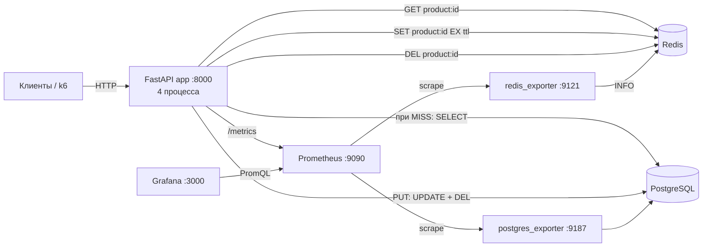
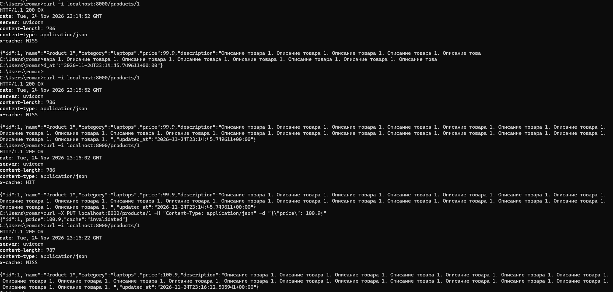
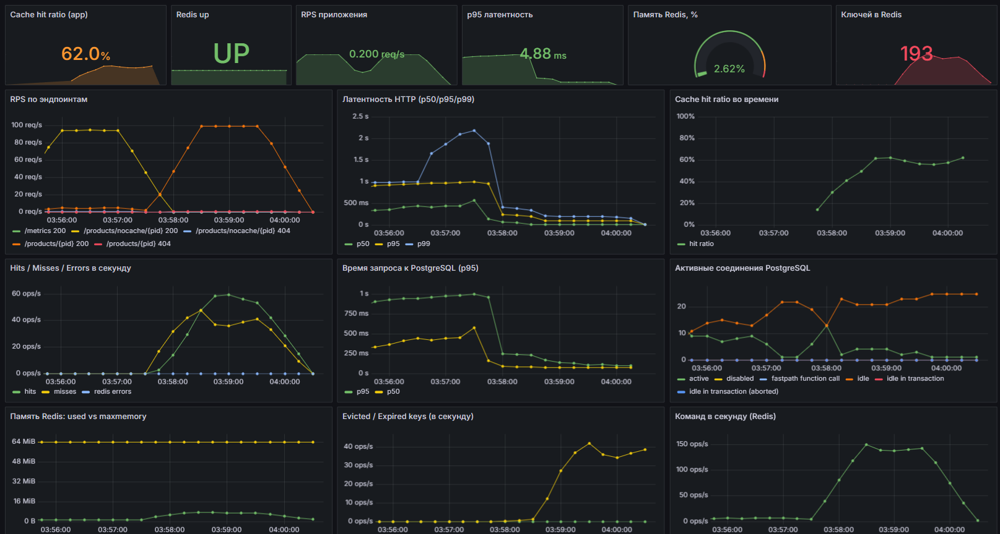
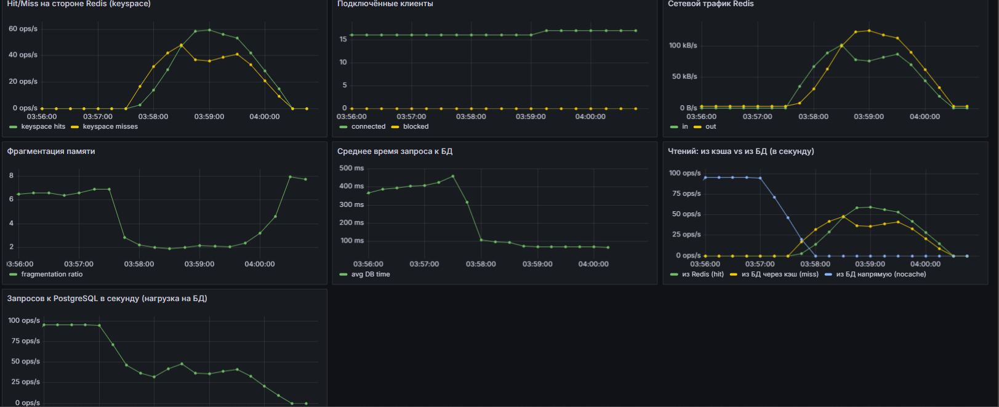

# Лабораторная работа №3 - Эксплуатация Redis

**Сценарий:** 1. Кэширование данных основной БД  
**Предметная область:** каталог товаров интернет-магазина  
**Стек:** Python 3.12 (FastAPI), PostgreSQL 16, Redis 7.2, Prometheus, Grafana, redis_exporter, postgres_exporter, k6

---

## 1. Описание задачи и требования

Интернет-магазин отдаёт карточки товаров через HTTP API. Нагрузка преимущественно на чтение, при этом небольшая часть товаров («хиты») запрашивается намного чаще остальных. Каждое чтение идёт в PostgreSQL, что даёт лишнюю нагрузку на БД и увеличивает время ответа. Карточка товара - это не простая выборка по ключу: она включает статистику отзывов (количество, средний рейтинг) и место товара в рейтинге своей категории, то есть требует агрегации по сотням тысяч строк. Задача: снизить нагрузку на БД и задержку чтения с помощью Redis.

### Функциональные требования
| # | Требование |
|---|-----------|
| F1 | `GET /products/{id}` - получить карточку товара (через кэш) |
| F2 | `GET /products/nocache/{id}` - то же без кэша (эталон для сравнения) |
| F3 | `PUT /products/{id}` - обновить цену, кэш товара инвалидируется |
| F4 | `GET /health`, `GET /metrics` - проверка состояния и метрики Prometheus |

### Нефункциональные требования
| # | Требование | Целевое значение |
|---|-----------|------------------|
| N1 | Доля попаданий в кэш (hit ratio) при профиле 80/20 | ≥ 80 % |
| N2 | Доля ошибок | < 2 % |
| N3 | Отказоустойчивость | При недоступности Redis сервис продолжает работать, читая из БД |
| N4 | Ограничение памяти | Redis ≤ 64 МБ, вытеснение по LRU |
| N5 | Допустимая устаревшесть данных | ≤ TTL (60 с ± 20 %), при записи - немедленная инвалидация |
| N6 | Разгрузка БД | Число запросов к PostgreSQL снижается пропорционально hit ratio, латентность чтения с кэшем заметно ниже, чем без него |

---

## 2. Архитектура



### Паттерн: Cache-aside
**Чтение:** приложение смотрит в Redis -> при попадании (HIT) возвращает данные -> при промахе (MISS) читает из PostgreSQL и кладёт результат в Redis с TTL.  
**Запись:** обновляем PostgreSQL, затем удаляем ключ из Redis (invalidate). Следующее чтение заполнит кэш свежими данными.

### Принятые проектные решения
| Решение | Обоснование |
|---------|-------------|
| Ключ `product:{id}`, значение - JSON | Простая структура, один GET на запрос |
| TTL 60 с с jitter ±20 % | Ограничивает устаревание. Jitter предотвращает одновременное истечение многих ключей |
| Negative caching (TTL 10 с) для несуществующих id | Защита БД от повторяющихся запросов к отсутствующим данным |
| Fallback на БД при ошибке Redis | Кэш - оптимизация, а не критичный компонент; сбой Redis не должен ронять сервис |
| `maxmemory 64mb` + `allkeys-lru` | Ограниченный объём, в кэше остаются самые «горячие» ключи |
| `--save ""`, `appendonly no` | Данные кэша восстановимы из БД, персистентность не нужна и только добавляет нагрузку |
| Карточка товара собирается дорогим запросом (агрегаты по отзывам + рейтинг в категории) | Кэширование здесь будет оправдано, т.к. запрос к источнику данных реально дорогой. Для простой выборки по первичному ключу выигрыш был бы близок к нулю |
| 4 процесса uvicorn + multiprocess-метрики Prometheus | Приложение (Python, один event loop на процесс) не должно быть узким местом системы |
| `max_parallel_workers_per_gather=0`, `shared_buffers=256MB` в PostgreSQL | Предсказуемая стоимость запроса (без скачков из-за параллелизма), данные целиком в памяти |

---

## 3. Структура проекта

```
.
├── docker-compose.yml
├── app/                        # сервис (FastAPI)
│   ├── main.py
│   ├── requirements.txt
│   └── Dockerfile
├── db/init.sql                 # схема, 10 000 товаров и 500 000 отзывов
├── loadtest/k6.js              # сценарий нагрузочного теста
├── prometheus/
│   ├── prometheus.yml
│   └── alerts.yml              # правила алертов
└── grafana/
    ├── provisioning/           # автоподключение datasource и дашборда
    └── dashboards/redis-cache.json
```

---

## 4. Развёртывание

```bash
docker compose up -d
```

| Сервис | Адрес |
|--------|-------|
| API | http://localhost:8000 (Swagger: `/docs`) |
| Prometheus | http://localhost:9090 |
| Grafana | http://localhost:3000 (admin / admin) - дашборд **Redis cache: product catalog** |


**Проверим работоспособность:**

  
- Первый `GET /products/1` -> `X-Cache: MISS`
- Повторный `GET /products/1` -> `X-Cache: HIT`
- `PUT /products/1` (`{"price": 100.9}`) -> ответ `"cache": "invalidated"`
- Следующий `GET /products/1` -> снова `MISS`, новая цена `100.9`
---

---

## 5. Реализованное приложение

Файл [`app/main.py`](app/main.py). Основные элементы:

- `GET /products/{id}` - cache-aside с TTL-jitter, negative caching, заголовок `X-Cache: HIT|MISS`;
- `GET /products/nocache/{id}` - прямое чтение из БД;
- `PUT /products/{id}` - UPDATE в БД + `DEL` ключа в Redis;
- `GET /health` - статус PostgreSQL и Redis;
- `GET /metrics` - метрики для Prometheus.

### Запрос карточки товара
Карточка собирается одним SQL-запросом: поля товара, число и средний рейтинг отзывов (индексированная выборка по `product_id`) и **место товара в рейтинге своей категории** - подзапрос агрегирует отзывы всех товаров категории и считает, сколько товаров имеют средний рейтинг выше. Именно этот подзапрос делает запрос «дорогим». Результат - JSON с дополнительными полями `reviews_count`, `avg_rating`, `category_rank`; тот же запрос используется и для `/products/{id}`, и для `/products/nocache/{id}`, поэтому сравнение честное.

Приложение запускается в 4 процессах, метрики Prometheus собираются в multiprocess-режиме (`PROMETHEUS_MULTIPROC_DIR`), пул соединений - 5 на процесс.

### Метрики приложения
| Метрика | Тип | Смысл |
|---------|-----|-------|
| `app_http_requests_total{method,endpoint,status}` | counter | Количество запросов |
| `app_http_request_duration_seconds{endpoint}` | histogram | Латентность HTTP |
| `app_cache_hits_total` / `app_cache_misses_total` | counter | Попадания / промахи кэша |
| `app_cache_errors_total` | counter | Ошибки Redis (сработал fallback) |
| `app_db_query_duration_seconds` | histogram | Время запроса к PostgreSQL |

---

## 6. Нагрузочное тестирование

Цель теста - сравнить систему без кэша (чтение напрямую из PostgreSQL) и с кэшем при одинаковой нагрузке и оценить, как кэш влияет на латентность и нагрузку на БД. Запрос карточки товара дорогой (агрегация по отзывам), поэтому именно он является потенциальным узким местом.

### 6.1 Методика
Постоянная нагрузка 100 запросов в секунду в течение 2 минут, одинаковая для обоих режимов. Профиль запросов: 95 % чтение / 5 % запись, 80 % чтений приходится на «горячие» 20 % товаров, ~1 % запросов к несуществующим id (k6 считает ответы 404 как `http_req_failed`, поэтому ≈ 1 % «ошибок» - это ожидаемые 404). Перед прогоном с кэшем Redis очищается, то есть кэш стартует холодным.

```bash
# 1. Эталон - всегда в PostgreSQL
docker compose --profile load run --rm -e MODE=nocache -e RATE=100 k6

# 2. Сброс кэша и прогон с кэшем
docker compose exec redis redis-cli flushall
docker compose --profile load run --rm -e MODE=cache -e RATE=100 k6
```

### 6.2 Результаты

| Метрика | Без кэша | С кэшем | Изменение |
|---------|----------|---------|-----------|
| Запросов выполнено | 12 001 | 12 000 | - |
| Средний RPS | 99.5 | 99.9 | - |
| Латентность avg | 387 мс | 38.6 мс | ≈ в 10 раз ниже |
| Латентность p50 (median) | 440 мс | 3.07 мс | ≈ в 143 раза ниже |
| Латентность p90 | 722 мс | 89 мс | ≈ в 8 раз ниже |
| Латентность p95 | 800 мс | 119 мс | ≈ в 6.7 раза ниже |
| Латентность max | 1.58 с | 476 мс | ≈ в 3.3 раза ниже |
| `http_req_failed` | 0.80 % (97 из 12 001, все - 404) | 0.89 % (108 из 12 000, все - 404) | - |
| Проверки (checks) | 100 % | 100 % | - |
| Максимум активных VU | 71 | 24 | - |

Скриншоты дашборда за оба прогона (слева по времени без кэша около 03:56–03:58; справа с кэшем около 03:58–04:00):




### 6.3 Анализ

**1. Кэш радикально снижает латентность.** При одинаковой нагрузке 100 RPS медиана упала с 440 мс до 3 мс (в ≈ 143 раза), среднее - в 10 раз, p95 - в 6.7 раза. Запрос к БД дорогой и каждое попадание в кэш экономит его целиком. Обе системы выдержали заданные 100 RPS без пропущенных итераций и без ошибок, кроме ожидаемых 404 (≈ 0.8–0.9 %), поэтому разница проявилась именно в латентности.

**2. Кэш разгружает PostgreSQL.** По дашборду без кэша к БД шло ≈ 95 запросов в секунду (все чтения), с кэшем - ≈ 35–48 (только промахи), то есть нагрузка на БД снизилась примерно в 2–2.5 раза. Среднее время запроса к БД, измеряемое приложением, упало с ≈ 360–460 мс до ≈ 70–100 мс, p95 - с ≈ 0.9–1 с до ≈ 100–250 мс, число активных соединений PostgreSQL - с ≈ 8–9 до ≈ 1–4.

**4. Проверка требований:**

| # | Требование | Результат |
|---|-----------|-----------|
| N1 | Hit ratio ≥ 80 % | ✗ не выполнено: ≈ 62 % (ограничен TTL при низком RPS) |
| N2 | Ошибок < 2 % | ✓ выполнено (≈ 0.9 %, все - ожидаемые 404; 5xx нет; ошибок Redis нет) |
| N3 | Работа при недоступности Redis | не проверялось экспериментально |
| N4 | Redis ≤ 64 МБ, вытеснение LRU | ✓ выполнено (пик ≈ 7–8 МиБ, вытеснений нет) |
| N5 | Устаревание ≤ TTL | ✓ обеспечивается конструкцией |
| N6 | Разгрузка БД, латентность ниже | ✓ запросов к БД ≈ 95 -> ≈ 35–48 в секунду, латентность чтения в разы ниже |

---

## 7. Мониторинг

### Компоненты
| Компонент | Что собирает |
|-----------|--------------|
| `/metrics` приложения | HTTP, кэш (hit/miss/error), время запросов к БД |
| `redis_exporter` | Метрики Redis из `INFO`: память, ключи, evictions, команды, клиенты |
| `postgres_exporter` | Состояние PostgreSQL (соединения и пр.) |
| Prometheus | Сбор раз в 5 с, правила алертов |
| Grafana | Визуализация|

### Алерты ([`prometheus/alerts.yml`](prometheus/alerts.yml))
| Алерт | Условие | Серьёзность |
|-------|---------|-------------|
| `RedisDown` | `redis_up == 0` 15 с | critical |
| `CacheHitRatioLow` | hit ratio < 60 % 2 мин | warning |
| `RedisMemoryHigh` | память > 90 % от maxmemory 2 мин | warning |
| `RedisEvictions` | вытеснения > 0 2 мин | warning |
| `AppLatencyP95High` | p95 > 100 мс 2 мин | warning |

Статус алертов: http://localhost:9090/alerts

---

## 8. Дашборд Grafana

Файл [`grafana/dashboards/redis-cache.json`](grafana/dashboards/redis-cache.json), открывается автоматически. Панели были представлены п 6 пункте.

## 9. Выводы

В этой лабораторной я выбрал сценарий кэширования данных основной БД и собрал небольшой, но полноценный стенд: каталог товаров на FastAPI, PostgreSQL как основное хранилище, Redis в роли кэша по схеме cache-aside, а вокруг этого Prometheus с экспортёрами и Grafana для наблюдения + k6 для нагрузки. Весь стенд поднимается одной командой через Docker Compose, а дашборд и источник данных подключаются автоматически, так что работу можно воспроизвести на чистой машине.

Отдельной задачей было сделать запрос к БД достаточно дорогим, чтобы кэширование имело смысл. Для этого пришлось добавить таблицу отзывов и считать по ней агрегаты и место товара в рейтинге категории. Кроме того, нужно было запустить приложение в нескольких процессах, а значит перейти на multiprocess-режим метрик Prometheus и понять, какие метрики Redis действительно полезны для оценки кэша, чтобы собрать из них читаемый дашборд.

Результат нагрузочного теста при 100 запросах в секунду оказался очень заметным: медиана латентности упала с 440 до 3 миллисекунд, среднее значение в десять раз (с 387 до 39 мс), p95 с 800 до 119 мс, а нагрузка на PostgreSQL по дашборду снизилась с ≈ 95 до ≈ 35–48 запросов в секунду. Память Redis при этом использовалась лишь на ≈ 11 %, вытеснений не было, так что ограничением был именно TTL, а не ресурсы. Чтобы это исправить, можно увеличить TTL или прогревать кэш, но в рамках работы я этого не проверял.

Главный практический вывод для меня в том, что кэш помогает тогда, когда обращение к источнику данных действительно дорогое, и что эффективность кэша зависит не только от его размера, но и от TTL и профиля запросов. Лаба выполнялась пару вечеров и оказалась интересной и поучительной. Когда я использовал простой запрос к БД, Redis не улучшил показатели - кэширование было нечего ускорять. Поэтому я сделал в этой лабе усложнение в виде сложного запроса к БД и вот тогда эффект кэша стал заметен.
