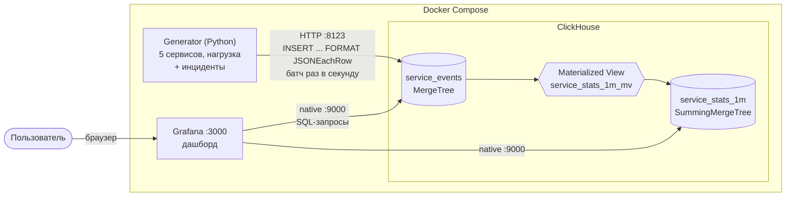
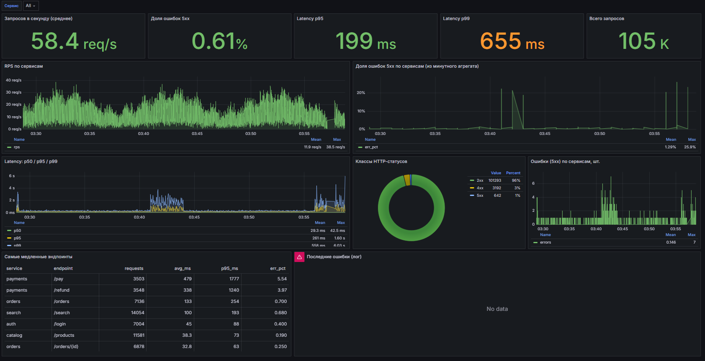

# Лабораторная работа №4 - Эксплуатация ClickHouse

Уровень аналитики: сервисные метрики и логи.  
Стек: ClickHouse 24.8, Grafana 11.2 (плагин `grafana-clickhouse-datasource`), Python-генератор событий, Docker Compose.

## 1. Задача и вопросы к системе

Есть условный интернет-магазин из 5 микросервисов (`auth`, `catalog`, `search`, `orders`, `payments`).
Каждый сервис пишет по записи на каждый обработанный HTTP-запрос (access-лог + метрики).
Нужна система, которая хранит эти события и позволяет быстро находить проблемы без grep по файлам на серверах.

Вопросы, на которые отвечает дашборд:

1. Какая сейчас нагрузка и как она распределена по сервисам? (RPS)
2. Не растёт ли доля серверных ошибок (5xx) и у какого сервиса?
3. Как себя ведёт латентность - p50, p95, p99? 
4. Какие эндпоинты самые медленные и самые ошибочные?
5. Что именно упало? Последние ошибки с хостом, статусом, сообщением и `trace_id` для разбора.
6. Как делятся ответы по классам статусов (2xx/4xx/5xx)?

## 2. Показатели и обоснование

| Показатель | Описание и назначение |
|---|---|
| **Количество запросов в секунду (RPS)** | Показывает, сколько HTTP-запросов обрабатывает каждый микросервис за секунду. Позволяет оценивать текущую нагрузку, выявлять резкие скачки активности и периоды снижения трафика. |
| **Доля серверных ошибок (5xx)** | Отражает процент запросов, завершившихся серверными ошибками. Рост этого показателя может свидетельствовать о сбоях в работе микросервисов, проблемах с базой данных или недоступности внешних зависимостей. |
| **Время ответа (Latency p50/p95/p99)** | Показывает, сколько времени занимает обработка HTTP-запросов. Анализируется медианное время ответа (p50), а также время ответа для 95% и 99% запросов (p95 и p99). Это позволяет выявлять не только общее замедление системы, но и отдельные запросы с очень большим временем обработки. |
| **Самые медленные эндпоинты** | Позволяет определить HTTP-методы и эндпоинты, которые дольше всего обрабатывают запросы. Помогает выявлять проблемные участки приложения и определять направления для оптимизации. |
| **Распределение HTTP-статусов** | Показывает соотношение успешных запросов (2xx), клиентских ошибок (4xx) и серверных ошибок (5xx). Позволяет получить общую картину качества обработки запросов. |
| **Журнал ошибок** | Отображает последние зарегистрированные ошибки с указанием микросервиса, хоста, HTTP-статуса, сообщения об ошибке и `trace_id`. Позволяет перейти от обнаружения проблемы к анализу её конкретной причины. |

Я использую подход RED (Rate, Errors, Duration). По сути это стандарт для мониторинга сервисов.
## 3. Архитектура


### Поток данных

Генератор формирует события для пяти микросервисов и каждую секунду отправляет их пакетами в ClickHouse через HTTP-интерфейс. Данные сохраняются в таблице `service_events`. После вставки новых записей материализованное представление автоматически обрабатывает их и формирует минутные агрегаты, которые сохраняются в таблице `service_stats_1m`. Grafana использует обе таблицы:
- `service_events`: используется для анализа ошибок, отдельных запросов и времени ответа;
- `service_stats_1m`: используется для построения графиков нагрузки и доли серверных ошибок.

## 4. Схема таблицы и обоснование решений

Полное описание схемы таблицы находится в файле [`clickhouse/init/01_schema.sql`](clickhouse/init/01_schema.sql). Скрипт выполняется автоматически при первом запуске контейнера ClickHouse.

### Выбор движка
Для хранения событий используется `MergeTree`. Он подходит для данной задачи, поскольку данные записываются в таблицу последовательно, а уже сохранённые события не изменяются и не удаляются вручную. Основная нагрузка приходится на аналитические запросы, поэтому важны эффективное чтение и сжатие данных.

### Ключ сортировки
В качестве ключа сортировки выбран `(service, endpoint, timestamp)`. Такой порядок соответствует основным запросам дашборда: чаще всего данные фильтруются по названию сервиса и временному интервалу, а затем группируются по сервисам и эндпоинтам. Колонки расположены с учётом их кардинальности:
- `service` - около 5 уникальных значений;
- `endpoint` - около 12 уникальных значений;
- `timestamp` - время регистрации события.

Благодаря такому порядку записи одного сервиса и эндпоинта располагаются рядом. Это позволяет ClickHouse эффективнее использовать разреженный первичный индекс при чтении данных и улучшает сжатие. Вариант с сортировкой только по `timestamp` был бы менее удобен для текущих сценариев: при фильтрации по конкретному сервису пришлось бы дополнительно проверять данные внутри выбранного временного диапазона.

### Ключ партиционирования
Для разделения данных используется `toDate(timestamp)`, то есть партиционирование по дням. Это решение упрощает обслуживание таблицы и удаление устаревших данных по TTL. Кроме того, при запросах за определённый период ClickHouse может обращаться только к необходимым дневным партициям. Другие варианты рассматривались, но для данного проекта подходят хуже:
- **По часам** - привело бы к образованию большого количества небольших партиций.
- **По месяцам** - сделало бы партиции слишком крупными и менее удобными для удаления устаревших данных.

При хранении событий за последние 30 дней получается около 30 партиций, что является приемлемым вариантом для данного объёма данных.

### Выбор типов данных

При проектировании таблицы для каждой колонки выбран тип данных с учётом характера хранимой информации, ожидаемого количества уникальных значений и занимаемого места.

| Колонка | Тип данных | Обоснование |
|---|---|---|
| `timestamp` | `DateTime64(3, 'UTC')` + `Delta, ZSTD` | Обеспечивает точность до миллисекунд и хранение времени в UTC. Кодек Delta улучшает сжатие последовательных временных значений. |
| `service`, `host`, `method`, `endpoint` | `LowCardinality(String)` | Подходит для колонок с небольшим количеством уникальных значений. Использование словарного кодирования позволяет сократить объём хранения и ускорить группировки. |
| `status` | `UInt16` | Используется для хранения HTTP-кодов ответа в диапазоне от 100 до 599. |
| `duration_ms` | `UInt32` | Хранит время обработки запроса в целых миллисекундах. Диапазона типа достаточно для ожидаемых значений. |
| `bytes_sent` | `UInt32` + `T64, ZSTD` | Хранит размер отправленного ответа в байтах. Кодеки позволяют эффективнее сжимать числовые значения. |
| `level` | `Enum8('INFO', 'WARN', 'ERROR')` | Для уровня логирования предусмотрен фиксированный набор значений. Тип занимает меньше места, чем обычная строка. |
| `user_id` | `UInt32` | Используется для хранения числового идентификатора пользователя. |
| `trace_id` | `UUID` + `bloom_filter` | UUID занимает 16 байт вместо 36 символов в строковом представлении. Bloom Filter позволяет ускорить поиск событий по конкретному идентификатору трассировки. |
| `message` | `String` + `ZSTD(3)` | Используется для хранения текстовых сообщений и описаний ошибок. Кодек ZSTD обеспечивает эффективное сжатие текста. |

### Политика хранения данных (TTL)
Для основной таблицы установлен TTL в 30 дней. По истечении этого срока старые события автоматически удаляются. Это позволяет ограничить объём занимаемого дискового пространства и не допускать бесконтрольного роста таблицы при постоянном поступлении новых событий.

### Агрегация данных

Для ускорения аналитических запросов дополнительно используется материализованное представление `service_stats_1m` на базе `SummingMergeTree`. Оно хранит агрегированные данные с разбивкой по минутам: количество запросов, количество ответов с кодом 5xx и суммарное время обработки запросов. Срок хранения агрегированных данных составляет 180 дней. Поскольку вместо отдельных событий сохраняются уже рассчитанные показатели, объём данных значительно меньше по сравнению с основной таблицей. Например, при выборе периода в 30 дней дашборду не требуется обрабатывать все исходные HTTP-запросы для построения графика нагрузки или доли ошибок. Он использует готовые минутные агрегаты, что существенно сокращает объём читаемых данных.

## 5. Сбор данных
Для сбора данных используется генератор событий [`generator/generator.py`](generator/generator.py), написанный на Python с использованием стандартной библиотеки. Он имитирует работу пяти микросервисов интернет-магазина и формирует события, которые затем записываются в ClickHouse.

### Особенности генератора
Генератор моделирует работу каждого микросервиса с учётом нескольких параметров:

- **Разная нагрузка на сервисы.** Для каждого микросервиса задан собственный вес трафика, количество хостов и набор эндпоинтов. Например, каталог товаров получает больше запросов, чем сервис оплаты.
- **Разное время ответа.** Для каждого эндпоинта задано базовое время обработки запроса. Фактическая латентность генерируется с помощью логнормального распределения, что позволяет имитировать ситуации, когда большинство запросов выполняется быстро, но некоторые занимают значительно больше времени.
- **Ошибки при обработке запросов.** Для каждого эндпоинта задана вероятность серверной ошибки (5xx). Также генератор создаёт клиентские ошибки (4xx), успешные ответы (2xx) и предупреждения для медленных запросов.
- **Изменение нагрузки.** Количество запросов в секунду меняется волнообразно с помощью двух синусоидальных функций и случайного шума. Средний уровень нагрузки задаётся параметром `BASE_RPS`.

### Имитация сбоев
Для проверки работы мониторинга предусмотрен искусственный инцидент в микросервисе `payments`. Каждые 15 минут в течение трёх минут (с 11-й по 13-ю минуту цикла) генератор увеличивает:
- вероятность серверных ошибок примерно в 25 раз;
- время обработки запросов примерно в 5 раз.

### Начальная загрузка данных
При запуске генератор предварительно заполняет таблицу историческими событиями. Продолжительность этого периода задаётся параметром `BACKFILL_MINUTES`. Это сделано для того, чтобы после запуска системы дашборд сразу отображал данные за выбранный период, а не оставался пустым до накопления первых событий.

### Запись данных в ClickHouse
Для передачи событий используется HTTP-интерфейс ClickHouse и формат `JSONEachRow`. Новые события накапливаются в течение одной секунды и отправляются одним пакетным запросом. Если ClickHouse временно недоступен, генератор повторяет попытку записи до 30 раз с интервалом в 2 секунды. Если все попытки оказываются неудачными, работа генератора завершается с ошибкой.

## 6. Grafana

- Datasource и дашборд подключаются автоматически: [`grafana/provisioning/`](grafana/provisioning), [`grafana/dashboards/service-overview.json`](grafana/dashboards/service-overview.json).
- JSON дашборда генерируется скриптом [`scripts/build_dashboard.py`](scripts/build_dashboard.py).
- Есть переменная `Сервис` (мультивыбор) и автообновление раз в 10 секунд.


## 7. Запуск

```bash
docker compose up -d --build
```

* Grafana: http://localhost:3000 (admin / admin) 

## 8. Структура проекта
```
├── docker-compose.yml                  # Запуск всех компонентов системы
├── clickhouse/
│   └── init/
│       └── 01_schema.sql               # Создание БД, таблиц и материализованного представления
├── generator/
│   ├── Dockerfile                      # Сборка образа генератора
│   └── generator.py                    # Генерация и отправка событий в ClickHouse
├── grafana/
│   ├── provisioning/
│   │   └── ...                         # Настройка источника данных и загрузки дашбордов
│   └── dashboards/
│       └── service-overview.json       # Дашборд мониторинга микросервисов
├── scripts/
│   └── build_dashboard.py             # Генерация JSON-файла дашборда
└── docs/
    └── img/                            # Скриншоты 
```

## 9. Выводы

На выполнение лабораторной работы потребовалось пару дня. В процессе разработки пришлось решить несколько практических задач, связанных с проектированием таблиц ClickHouse и настройкой мониторинга. В частности, при выборе ключа сортировки было решено использовать `(service, endpoint, timestamp)`, поскольку основные запросы дашборда фильтруют данные по сервисам и времени. Также пришлось разделить расчёт метрик: минутные агрегаты используются для подсчёта количества запросов и ошибок, а процентильные показатели p95 и p99 рассчитываются по исходным событиям, поскольку обычное суммирование не позволяет корректно восстановить распределение времени ответа. Для снижения нагрузки на ClickHouse вместо отдельных INSERT для каждого события была реализована пакетная запись раз в секунду. В ходе работы удалось разобраться с особенностями ClickHouse, в частности с движком `MergeTree`, ключами сортировки и партиционированием, кодеками сжатия и материализованными представлениями. Особенно полезным оказалось то, что материализованные представления позволяют автоматически формировать агрегированные данные при поступлении новых событий. В общем и целом, лабораторная работа оказалась интересной и полезной.
